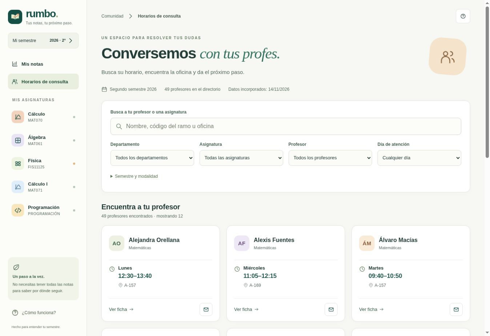

# Rumbo · Tus notas, tu próximo paso

Calculadora, simulador de notas y directorio de horarios de consulta para la comunidad USM. Conserva cinco calculadoras con reglas independientes. Puedes ingresar solo las notas conocidas y ver requisitos, objetivos y alternativas de recuperación. Las notas se guardan exclusivamente en el navegador.


**Página pública:** [Abrir Rumbo](https://visionstick.github.io/ponderaciones/)

## Asignaturas

- Introducción al Cálculo — MAT070.
- Cálculo en una Variable — MAT071.
- Álgebra Lineal — MAT061.
- Física General Mecánica — FIS11125, con laboratorio FIS111L.
- Introducción a la Programación.

La primera tarjeta destaca cuánto necesitas. La tabla de casos compara combinaciones concretas y permite probarlas como simulación y deshacerlas. Física calcula el laboratorio desde IS, IN y controles de laboratorio, incluyendo las evaluaciones pendientes.

Cada asignatura tiene reglas independientes. La app distingue notas reales y simuladas, campos vacíos y ceros, aprobación directa y recuperación, y resultados definitivos y condicionados.

## Directorio de profesores



La primera nómina contiene **49 profesores de Matemáticas**, Campus San Joaquín, semestre 2026-2: **56 franjas semanales y 3 atenciones por coordinación**. Búsqueda por nombre sin tildes, oficina y asignatura; filtros por departamento, profesor, día, semestre y modalidad. Cada ficha reúne horarios, oficina, correo profesional, observaciones y procedencia.

El Excel no informa qué asignaturas o paralelos imparte cada profesor. Esos vínculos están pendientes: no se deducen por departamento. Las calculadoras enlazan con el directorio y mostrarán automáticamente a sus profesores cuando se registren las relaciones.

El [editor del directorio](admin.html) prepara borradores locales, valida los datos y exporta un catálogo. Publicar una actualización requiere sustituir **solo `data/directory.json`**, comprobarlo y subirlo al repositorio. El editor no escribe en producción y no tiene credenciales. No hay una base de datos remota ni administración multiusuario en esta versión. El modelo está normalizado y el acceso a datos separado de la interfaz para migrar a una API con autenticación cuando exista un servicio institucional. Véase [mantenimiento del directorio](docs/directorio.md).

## Abrir y desarrollar

El sitio es estático, sin dependencias de producción ni instalación de paquetes. Requiere JavaScript moderno con `BigInt` y módulos ES. No se debe abrir con `file://`: usa un servidor HTTP local.

```bash
python3 -m http.server 8000
```

Abre `http://localhost:8000`. Para validar y preparar los archivos de publicación (Node.js 22 o superior):

```bash
npm run check
npm test
npm run build
```

`dist/` contiene el sitio publicable. El contenido fuente de la raíz también funciona directamente, con rutas relativas compatibles con `/ponderaciones/`.

## GitHub Pages

La página pública está activa y verificada. Para revisar o cambiar el origen de publicación en este repositorio: **Settings → Pages → Build and deployment → Source: Deploy from a branch → Branch: main → /(root) → Save**.

El sitio no requiere Jekyll ni una etapa de compilación para esta modalidad. `.nojekyll` lo indica explícitamente. Tras la activación inicial, los cambios en `main` se publican por GitHub Pages. La activación de Pages requiere permisos de administración; no se deben incluir tokens en el repositorio ni pedirlos en un chat.

El workflow de comprobaciones ejecuta las verificaciones de sintaxis, las pruebas y la preparación de `dist/` en cada cambio. No activa Pages ni modifica la visibilidad del repositorio.

## Estructura

| Archivo | Responsabilidad |
| --- | --- |
| `src/courses.js` | Catálogo, campos, parámetros, textos y fuentes |
| `src/engine.js` | Reglas académicas, escenarios, límites y mensajes |
| `src/scenarios.js` | Combinaciones de notas y cálculo independiente del laboratorio |
| `src/rational.js` | Fracciones exactas y validación decimal |
| `src/state.js` | Datos, versión, importación y almacenamiento |
| `src/app.js` | Interfaz y comportamiento |
| `styles.css`, `directory.css` | Diseño responsive y accesibilidad visual |
| `data/directory.json` | Catálogo único normalizado de departamentos, docentes, docencia y atención |
| `src/directory.js` | Validación, búsqueda, relaciones, carga HTTP y edición transaccional |
| `src/directory-view.js` | Buscador, tarjetas, fichas y acceso desde cada ramo |
| `admin.html`, `src/admin.js` | Editor de borradores locales y exportación validada |
| `tests/directory*.test.mjs` | Integridad, filtros, carga y transcripción de la nómina original |
| `tests/physics-global.test.mjs` | Oráculo independiente y límites de Global, 19.080 combinaciones |
| `tests/academic.test.mjs` | Casos numéricos y restricciones por ramo |
| `tests/improvements.test.mjs` | Umbrales, Física, casos y conservación de datos |
| `tests/mat071-current.test.mjs` | Reglamento corregido de MAT071, Global, factores y migración |
| `tests/data.test.mjs` | Valores inválidos, precisión y respaldos |
| `docs/reglas-2026-2.md` | Contrato académico y decisiones documentadas |
| `docs/agregar-asignaturas.md` | Cómo extender o actualizar el sitio |

## Precisión y límites conocidos

- Reglas `2026-2.4`: aprobación final desde54,5 y presentación al Global de Física desde49,5, según corrección del usuario. Varios certámenes de Física bajo50 permiten ir a Global si NL≥55 y PS≥49,5; se exige G≥50 y NF≥54,5. Los mínimos específicos de laboratorio, certámenes y Global se verifican por separado.
- Las decisiones comparan fracciones exactas:54,499999 no se convierte en54,5 por redondeo visual.
- El mínimo sugerido se eleva a centésimas y se muestra también el entero suficiente. No se inventa redondeo administrativo de la universidad.
- MAT071 usa las capturas corregidas entregadas el 27/10/2026: tres certámenes (75%), tres controles (25%), factor L entre 0,9 y 1,1, tope 100 y Global voluntario que siempre reemplaza el peor certamen. La pauta detallada de laboratorio menciona MAT061; se usa solo al confirmar que corresponde al paralelo, o se ingresa directamente el factor oficial.
- MAT070 menciona **6 y 8 controles** en secciones diferentes. El estudiante confirma el total en AULA o ingresa el promedio final oficial; hasta entonces el resultado es condicionado.
- Física presenta factores de asistencia de cátedra y laboratorio sin explicar su combinación. Se usa el factor efectivo confirmado, o α=1 cuando las tres asistencias alcanzan el 80%. Los factores no se multiplican entre sí automáticamente.
- FIS111L no especifica cantidades de experiencias; se confirman los totales de IS, IN y CI antes de calcular un mínimo final. EF/ECA de Programación tampoco detallan todas sus notas. Se pueden configurar cantidades previstas o ingresar promedios **finales** oficiales. Un promedio provisional se debe simular, no registrar como final.
- En Álgebra, un cero sancionado bloquea la proyección automática del reemplazo hasta aclarar el certamen habilitado.
- En Física se modela una ausencia justificada a certamen. El reglamento no define inequívocamente múltiples ausencias; esos casos requieren coordinación.
- Las situaciones excepcionales, sanciones y autorizaciones institucionales no se inventan ni sustituyen mediante el cálculo.

Las notas de las versiones 2026-2.1, 2026-2.2 y 2026-2.3 se migran explícitamente, conservando las notas reales, las simuladas y el formato anterior de laboratorio. Taller y η del programa antiguo de MAT071 quedan como datos históricos y no participan en el nuevo cálculo. Se avisa al usuario al cargar sus datos. Los ejemplos también conservan sus ajustes simulados al recargar, separados de la configuración real.

## Privacidad

La interfaz no contiene enlaces al repositorio. Esto elimina el acceso directo desde el sitio; no modifica la visibilidad pública del repositorio ni añade control de acceso a GitHub Pages.

Sin cuentas, analítica ni cookies de seguimiento. El catálogo de horarios se descarga del mismo sitio, sin transmitir notas. Los enlaces de contacto abren el programa de correo del estudiante; no envían mensajes automáticamente. Las notas se guardan en `localStorage`. Los respaldos JSON incluyen notas reales, simuladas y configuración; el usuario elige cuándo descargarlos o importarlos. No se suben al repositorio ni al servidor.

Los documentos fuente se identifican por título, páginas y huella SHA-256 en la documentación. No se publican los documentos originales ni datos personales del estudiante. El catálogo contiene únicamente la información profesional de atención solicitada por el responsable del proyecto.
